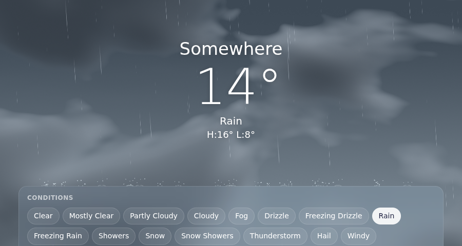

# weather-effects

Rain, snow, hail, fog and clouds that fall over your web page, splash on your headings and refract your background.

[](https://www.npmjs.com/package/weather-effects)
[](https://github.com/Ashwyn28/weather-effects/actions/workflows/ci.yml)
[](LICENSE)
[](#install)



**[Live demo](https://ashwyn28.github.io/weather-effects/demo.html)**

## Quick start

```js
import * as THREE from 'three';
import { attachWeather } from 'weather-effects';

const weather = attachWeather({ condition: 'rain', surfaces: 'h1, h2, .card', three: THREE });
weather.setWeather('snow', { night: true });
weather.destroy(); // removes the canvases, listeners and observers
```

`attachWeather` creates the canvases, resolves surfaces from a selector, element list or function, and wires resize, scroll, mutation and pointer handling. See [`examples/minimal.html`](examples/minimal.html).

## Features

- **15 conditions:** clear, mainly clear, partly cloudy, overcast, fog, drizzle, freezing drizzle, rain, freezing rain, showers, snow, snow showers, thunderstorm, hail and wind. Conditions ease into each other over about a second and a half.
- **Collisions:** rain splashes, hail bounces and snow settles on surfaces you supply, with swept collision so fast rain cannot tunnel through thin edges.
- **Clouds and stars backdrop:** clouds, fog, stars, sun and moon on a canvas behind your content, so text stays crisp.
- **Glass drops:** running drops and frost on a pane of glass, refracting a background you supply.
- **Reduced motion:** `prefers-reduced-motion` keeps a static frame.
- **2D fallback:** without Three.js or WebGL, a 2D canvas draws precipitation, splashes, snow and simple fog and cloud gradients.
- **Deterministic:** `seed` and `seek(t)` replay the same weather.
- **No runtime dependencies and no bundler needed.** Three.js is optional and injected, so pages with a strict `script-src 'self'` policy need no import map.

## Install

From npm:

```sh
npm install weather-effects three
```

From a CDN, as ES modules:

```html
<script type="importmap">
  { "imports": { "three": "https://cdn.jsdelivr.net/npm/three@0.186.0/build/three.module.js" } }
</script>
<script type="module">
  import * as THREE from 'three';
  import { attachWeather } from 'https://cdn.jsdelivr.net/npm/weather-effects/dist/index.js';
  attachWeather({ condition: 'rain', three: THREE });
</script>
```

Three.js r160 or later is optional. To build from source, run `npm install && npm run build` and import `dist/index.js`. To try the demo locally, build, then `npm run demo` and open <http://127.0.0.1:8000/demo.html>.

## Core concepts

**Overlay and backdrop.** The _overlay_ canvas sits above your content (`pointer-events: none`) and draws precipitation. The optional _backdrop_ canvas sits behind your content and draws clouds, fog, stars and sun glow.

```html
<canvas class="clouds"></canvas>
<!-- position: fixed; inset: 0; z-index: 0 -->
<main style="position: relative; z-index: 1">…</main>
<!-- transparent background -->
<canvas class="weather"></canvas>
<!-- position: fixed; inset: 0; z-index: 2; pointer-events: none -->
```

```js
import { createWeatherEffects } from 'weather-effects';

const effects = createWeatherEffects({
  canvas: weatherCanvas,
  backdropCanvas: cloudsCanvas,
  three: THREE,
});
```

`backdropStyle: 'clouds'` (default) keeps your page background; `'sky'` paints an opaque sky gradient and draws rain as long light streaks.

**Surfaces.** A surface is a ledge (two points) or polygon (more) that particles collide with. Pass a list or a function returning a fresh list, and call `invalidate()` after layout changes.

**Background for drops.** Droplets refract only the background you supply: an image, canvas, video or paint function. It is redrawn after `invalidate()` or a weather change, at most 2048px on the long side. Other page content shows through unchanged and stays interactive.

```js
import { createWeatherEffects } from 'weather-effects';

const canvas = document.querySelector('canvas.weather'); // position: fixed; inset: 0; pointer-events: none
const effects = createWeatherEffects({ canvas, three: THREE, seed: 1 });
effects.resize(innerWidth, innerHeight);
effects.setSurfaces(() =>
  [...document.querySelectorAll('h2')].map((el) => {
    const r = el.getBoundingClientRect();
    return {
      points: [
        { x: r.left, y: r.top },
        { x: r.right, y: r.top },
      ],
    };
  }),
);
effects.setBackground(document.querySelector('img.hero')); // droplets refract this
effects.setWeather('rain', { night: false, reading: { windSpeed: 20, windDirection: 250 } });
addEventListener('resize', () => effects.resize(innerWidth, innerHeight));
addEventListener('scroll', () => effects.invalidate({ clearDeposits: true }), { passive: true });
```

Glass drops work on their own, without Three.js or the page layer, for a window in an illustration:

```js
import { createGlassDroplets } from 'weather-effects';

const glass = createGlassDroplets({ canvas: windowCanvas, dropSize: 70 });
glass.setBackground((ctx, { width, height }) => ctx.drawImage(windowImage, 0, 0, width, height));
glass.resize(windowCanvas.clientWidth, windowCanvas.clientHeight);
glass.setWeather('rain', { night: false });
```

## API overview

| Export                          | Purpose                                                                                                                                                      |
| ------------------------------- | ------------------------------------------------------------------------------------------------------------------------------------------------------------ |
| `attachWeather(options)`        | One-call setup. Returns `{ effects, setWeather, play, pause, invalidate, destroy }`.                                                                         |
| `createWeatherEffects(options)` | Full control with your own canvases.                                                                                                                         |
| `createGlassDroplets(options)`  | Drops and frost on a small pane of glass.                                                                                                                    |
| `CONDITIONS`, `isCondition(id)` | The condition ids and a type guard.                                                                                                                          |
| `weather-effects/advanced`      | `createSimulation`, `windAt`, `surfaceHit`, `settleSnow`, `hash32`, `particleRandom`, `particleVariant`, `isRain`, `isSnow`, `isFrozen`, `hasPrecipitation`. |

Types ship in `dist/*.d.ts` with TSDoc on every export. Mapping API data (for example WMO codes) to condition ids is the caller's job. A full API reference will be published on the docs site.

## Browser support

Modern evergreen browsers. With Three.js and WebGL2 you get refraction, frost and shader clouds. Without them, a 2D canvas fallback draws precipitation, splashes, snow and simple fog and cloud gradients. WebGL context loss hides the canvas, and restoration redraws.

## Accessibility and performance

- `prefers-reduced-motion` and `pause()` keep a static frame. Canvases are decorative and do not take pointer events.
- Rendering runs at about 30 fps, and hidden tabs stop.
- Particle counts are capped (450 rain, 240 snow or hail, 22 leaves) and halve with `saveData`.
- The refraction texture is capped at 2048px and refreshed on change, not every frame.
- `dispose()` and `destroy()` stop the loop, remove listeners and free GPU resources.

## Contributing

See [CONTRIBUTING.md](CONTRIBUTING.md) and the [Code of Conduct](CODE_OF_CONDUCT.md). Report vulnerabilities as described in [SECURITY.md](SECURITY.md). Changes are listed in [CHANGELOG.md](CHANGELOG.md).

The integer hash in `random.ts` and `shaders/droplets.ts` is lowbias32 by Chris Wellons (public domain).

## License

[MIT](LICENSE)
