# Conditions

There are 15 conditions. Pass any of them to `attachWeather({ condition })` or
`setWeather(condition)`. Changing condition eases between the two over about a second and a half.
The `CONDITIONS` array lists every id and `isCondition(value)` checks untrusted input, such as an API response.

```js
import { CONDITIONS, isCondition } from 'weather-effects';

CONDITIONS.length; // 15
isCondition('rain'); // true
```

Mapping weather data (for example WMO codes) onto these ids is covered in [Day/night and live data](/guide/live-data).

## `clear`

Clear sky.

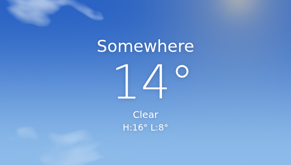

## `mainly-clear`

Mostly clear, a few thin clouds.

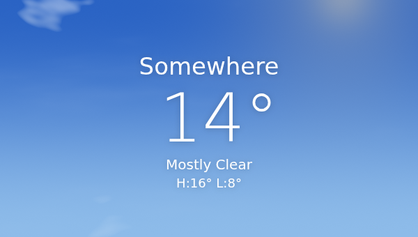

## `partly-cloudy`

Broken clouds with sun or moon showing through.

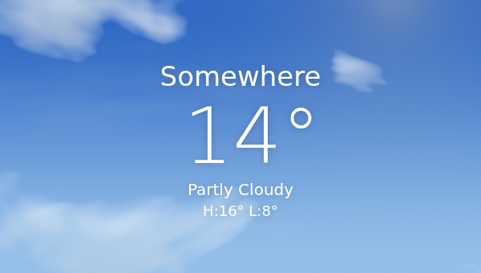

## `overcast`

Full cloud cover.

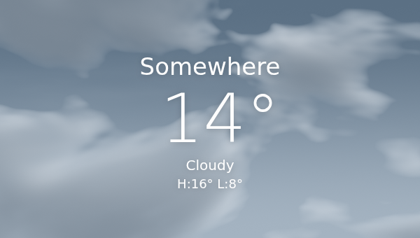

## `fog`

Fog drifting over the page.

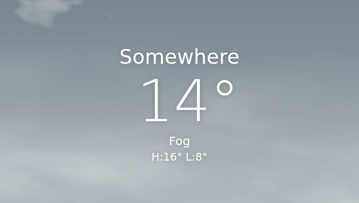

## `drizzle`

Light, fine rain.

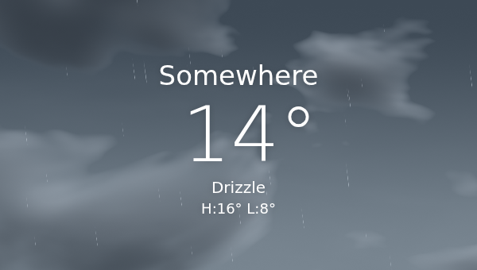

## `freezing-drizzle`

Fine drizzle that freezes on contact.

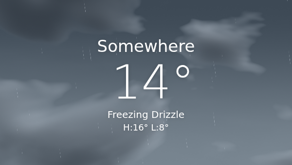

## `rain`

Steady rain with splashes on surfaces.


## `freezing-rain`

Rain falling as ice.

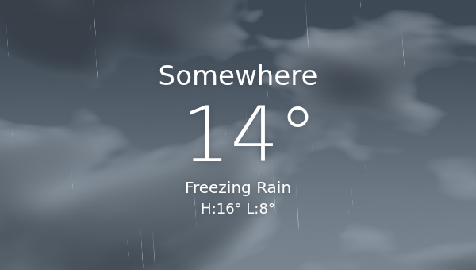

## `showers`

Heavier, shorter bursts of rain.

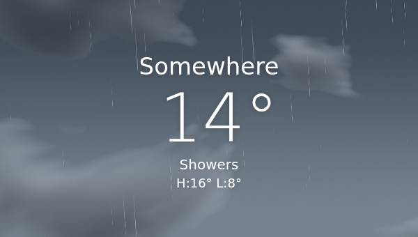

## `snow`

Snowfall that settles on surfaces.

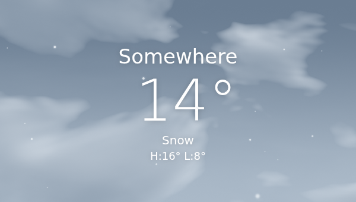

## `snow-showers`

Heavier bursts of snow.

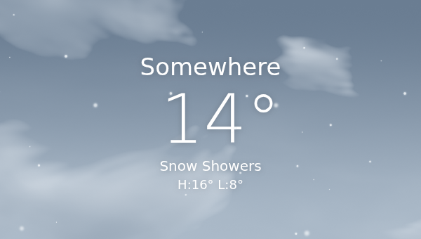

## `thunderstorm`

Heavy rain with lightning.

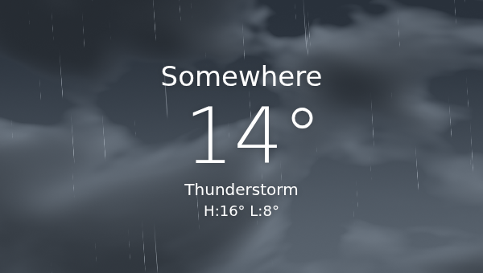

## `hail`

Hailstones that bounce off surfaces.

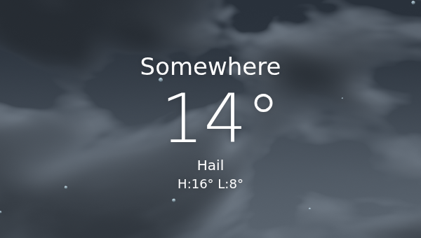

## `wind`

Windblown leaves and gusts.

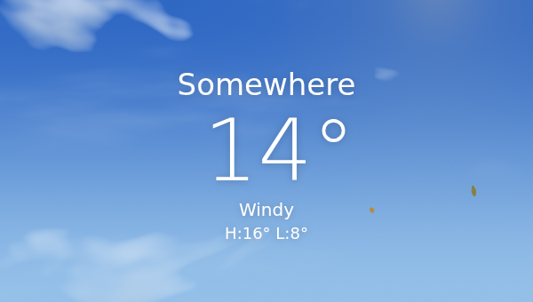
