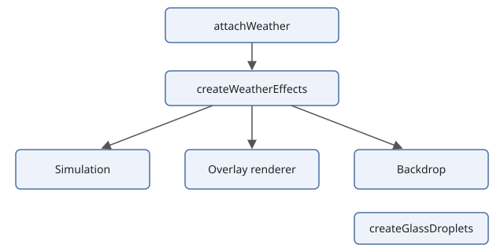

# How it works

- **Simulation** (`createSimulation`). A deterministic particle simulation that steps rain, snow, hail and leaves, applies wind and handles collisions with surfaces. It has no DOM or GPU dependency, so it is testable and seedable.
- **Overlay renderer.** Draws the simulation on the overlay canvas, using Three.js when you supply it and a 2D canvas otherwise.
- **Backdrop.** Draws clouds, fog, stars and sun or moon on a canvas behind your content, with WebGL2 or a 2D fallback.
- **Glass.** `createGlassDroplets` is separate: a WebGL2 shader for drops and frost refracting a background you supply.
- **`createWeatherEffects`** wires the simulation, overlay renderer and backdrop together. **`attachWeather`** adds canvas creation, surface discovery and event listeners on top.

Every frame, the effects step the simulation, then each renderer draws its layer. Conditions are described by a single profile table, so adding a condition changes data rather than code.
